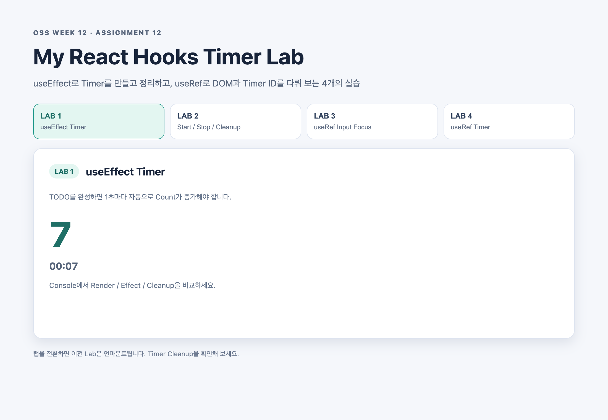
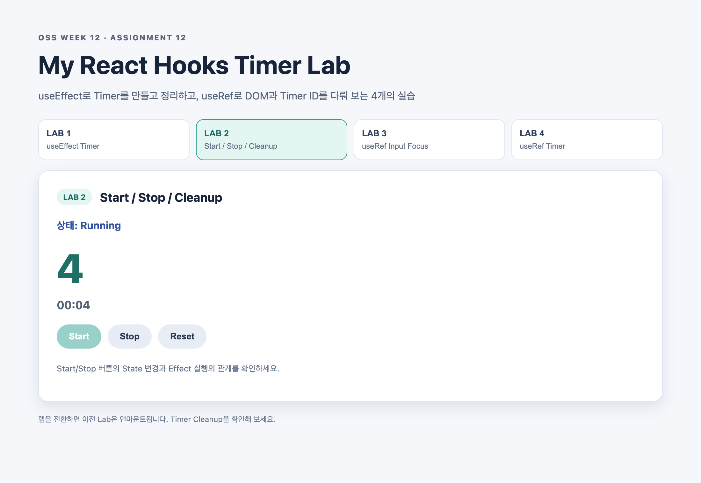
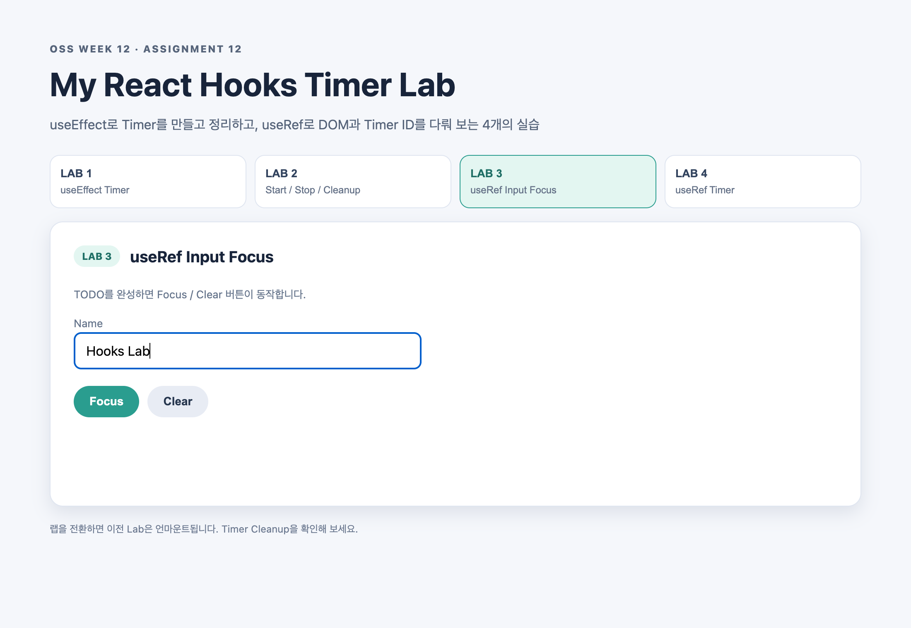
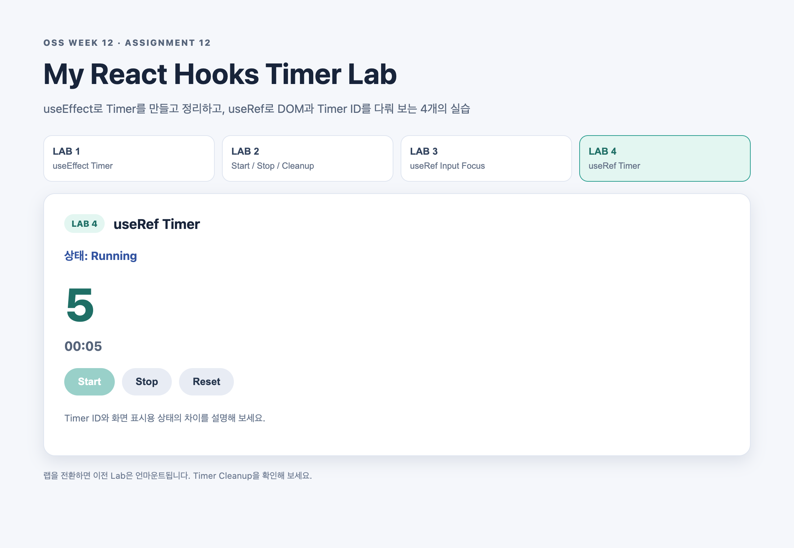

# My React Hooks Timer Lab

# Project Information

## 프로젝트 소개
- OSS 12주차 과제로 진행한 React Hooks 실습 프로젝트
- useEffect로 Timer를 만들고 정리(Cleanup)하는 방법과, useRef로 DOM 요소와 Timer ID를 다루는 방법을 4개의 Lab으로 구현
- 탭으로 Lab을 전환할 수 있고, 전환 시 이전 Lab 컴포넌트는 언마운트되어 Cleanup 동작을 확인할 수 있음

## Starter Project 정보
- Starter Project: https://github.com/2026-2-OSS/week12_starter_project
- 기술 스택: React 19, Vite 6, @vitejs/plugin-react
- 제공된 4개 Lab 컴포넌트의 TODO 부분을 직접 완성하는 형태

# Installation

## 설치 및 실행 방법
- Node.js 20.19 이상 또는 22.12 이상 권장
- 저장소 clone: git clone https://github.com/2026-2-OSS/assign12-c01-22300404.git
- 패키지 설치: npm install
- 개발 서버 실행: npm run dev
- 배포용 빌드: npm run build
- 터미널에 표시되는 Local URL(http://localhost:5173)을 브라우저에서 열어 확인

## 실행 화면
- LAB 1 - useEffect Timer
- 
- LAB 2 - Timer Start / Stop
- 
- LAB 3 - Input Focus with useRef
- 
- LAB 4 - Timer with useRef
- 

# Source Code Exploration

## 주요 파일 구조
- index.html : React 앱이 들어갈 root 요소가 있는 HTML 파일
- package.json : 프로젝트 이름, React/Vite 버전, dev/build/preview 실행 스크립트 정의
- src/main.jsx : root 요소에 App 컴포넌트를 렌더링하는 시작점, StrictMode 적용
- src/App.jsx : 4개 Lab 목록을 배열로 관리하고, active State로 선택된 Lab 하나만 화면에 렌더링
- src/App.css : 전체 화면, 탭, 카운트, 버튼 스타일
- src/components/Lab1_EffectTimer.jsx : useEffect로 자동 증가하는 Timer
- src/components/Lab2_TimerControl.jsx : running State와 useEffect로 Start/Stop/Reset 제어
- src/components/Lab3_InputFocus.jsx : useRef로 Input DOM 요소에 접근해 Focus 이동
- src/components/Lab4_RefTimer.jsx : useRef에 Timer ID를 저장해 이벤트 핸들러에서 직접 Timer 제어
- src/utils/formatTime.js : 초를 분:초 형식으로 바꾸는 함수 (Customizing으로 추가)

## App.jsx의 역할
- labs 배열에 id, 이름, 부제목, 컴포넌트를 묶어서 저장
- 탭 버튼을 누르면 setActive로 active 값이 바뀌고, 해당 Lab 컴포넌트만 렌더링됨
- 다른 탭으로 넘어가면 이전 Lab은 화면에서 사라지기 때문에(언마운트) Cleanup이 실행됨

## useEffect 동작 원리
- Effect : 렌더링이 끝나고 화면에 반영된 뒤 실행되는 함수로, Timer나 이벤트 등록처럼 React 바깥의 작업을 처리함
- Dependency Array : Effect를 언제 다시 실행할지 정하는 배열
  - [] 이면 처음 마운트될 때 한 번만 실행
  - [running] 이면 처음 마운트될 때와 running 값이 바뀔 때마다 실행
  - 배열을 생략하면 렌더링될 때마다 실행
- Cleanup : Effect에서 return한 함수로, 다음 Effect가 실행되기 전이나 컴포넌트가 언마운트될 때 실행되어 이전 작업을 정리함
- 개발 환경의 StrictMode에서는 Effect가 실행, 정리, 다시 실행되는 과정이 한 번 더 일어나서 Console에 로그가 두 번 찍힐 수 있음

## useRef 동작 원리
- useRef는 .current 속성을 가진 객체를 반환하고, 컴포넌트가 다시 렌더링되어도 같은 객체가 유지됨
- .current 값을 바꿔도 렌더링이 다시 일어나지 않음
- ref 속성으로 JSX 요소에 연결하면 .current에 실제 DOM 요소가 들어감
- useState와의 차이
  - useState : 값이 바뀌면 컴포넌트가 다시 렌더링되므로 화면에 보여줄 값에 사용
  - useRef : 값이 바뀌어도 렌더링되지 않으므로 DOM 참조나 Timer ID처럼 화면에 보일 필요 없는 값에 사용

## 주요 코드 분석 1 - useEffect (Lab2_TimerControl.jsx)
- 코드
  - useEffect(() => {
  - if (!running) return;
  - const id = setInterval(() => {
  - setCount(prev => prev + 1);
  - }, 1000);
  - return () => clearInterval(id);
  - }, [running]);
- 설명
  - Dependency Array가 [running] 이라서 Start나 Stop을 눌러 running 값이 바뀔 때마다 Effect가 다시 실행됨
  - running이 false이면 바로 return해서 Timer를 만들지 않음
  - running이 true이면 setInterval로 1초마다 count를 1씩 증가시킴
  - setCount(prev => prev + 1) 처럼 함수형 업데이트를 써서 항상 최신 count 값을 기준으로 계산함
  - Stop을 눌러 running이 false가 되면, Effect가 다시 실행되기 전에 Cleanup의 clearInterval(id)가 먼저 실행되어 Timer가 멈춤

## 주요 코드 분석 2 - useRef (Lab4_RefTimer.jsx)
- 코드
  - const timerRef = useRef(null);
  - const start = () => {
  - if (timerRef.current !== null) return;
  - timerRef.current = setInterval(() => {
  - setCount(prev => prev + 1);
  - }, 1000);
  - setRunning(true);
  - };
  - const stop = () => {
  - clearInterval(timerRef.current);
  - timerRef.current = null;
  - setRunning(false);
  - };
- 설명
  - timerRef.current에 setInterval이 반환한 Timer ID를 저장함
  - 일반 변수(let timerId)에 저장하면 렌더링될 때마다 함수가 다시 실행되어 값이 초기화되지만, useRef는 렌더링 사이에도 값이 유지됨
  - start에서 timerRef.current가 null이 아니면 이미 Timer가 실행 중이므로 return해서 중복 실행을 막음
  - stop에서 clearInterval로 Timer를 멈추고 timerRef.current를 null로 되돌려서 다시 Start할 수 있게 함
  - Timer ID는 화면에 보여줄 필요가 없어서 Ref로, 실행 상태는 화면에 표시해야 해서 running State로 따로 관리함

# Lab Implementation

## LAB 1 - useEffect Timer
- 수정 파일: src/components/Lab1_EffectTimer.jsx
- useEffect 안에서 setInterval로 1초마다 setCount(prev => prev + 1) 실행
- Dependency Array를 []로 설정해 마운트될 때 Timer를 한 번만 생성
- Cleanup에서 clearInterval(id)로 Timer 정리
- Effect 실행과 Cleanup 시점을 보기 위해 console.log 추가
- 실행 결과
  - 화면에 들어가면 1초마다 count가 자동으로 증가함
  - Console에 rendered, effect: timer start, cleanup: timer cleared 로그가 출력됨
  - 다른 탭으로 이동하면 cleanup 로그가 찍히고 Timer가 정리됨

## LAB 2 - Timer Start / Stop
- 수정 파일: src/components/Lab2_TimerControl.jsx
- running이 false면 Effect에서 바로 return
- running이 true면 setInterval로 1초마다 count 증가, Cleanup에서 clearInterval 호출
- Dependency Array를 [running]으로 설정
- Reset 버튼: setRunning(false)로 Timer를 멈추고 setCount(0)으로 초기화
- 중복 실행 방지: 실행 중에는 Start 버튼이 disabled 되고, running이 이미 true이면 값이 바뀌지 않아 Effect도 다시 실행되지 않음
- 실행 결과
  - Start를 누르면 상태가 Running으로 바뀌고 count가 증가함
  - Stop을 누르면 count가 그 자리에서 멈춤
  - Reset을 누르면 Stopped 상태가 되고 count가 0이 됨

## LAB 3 - Input Focus with useRef
- 수정 파일: src/components/Lab3_InputFocus.jsx
- useRef(null)로 inputRef를 만들고 input 요소에 ref={inputRef} 연결
- Focus 버튼: inputRef.current.focus()로 입력창에 커서 이동
- Clear 버튼: inputRef.current.value = '' 로 입력 내용을 지우고 다시 focus()
- 실행 결과
  - Focus 버튼을 누르면 입력창에 커서가 이동함
  - 글자를 입력한 후 Clear를 누르면 내용이 지워지고 커서가 입력창에 그대로 남아 있음

## LAB 4 - Timer with useRef
- 수정 파일: src/components/Lab4_RefTimer.jsx
- timerRef = useRef(null)에 Timer ID 저장
- start: timerRef.current가 있으면 return, 없으면 setInterval을 실행하고 running을 true로 변경
- stop: clearInterval 후 timerRef.current를 null로, running을 false로 변경
- reset: stop()을 실행한 뒤 count를 0으로 초기화
- useEffect의 Cleanup에서 clearInterval(timerRef.current)를 호출해 컴포넌트가 사라질 때 Timer 정리
- 실행 결과
  - Start, Stop, Reset이 모두 정상 동작함
  - Stop 후 다시 Start하면 멈췄던 값부터 이어서 증가함
  - 실행 중에 다른 탭으로 이동해도 Console에 오류가 없음

# Lab Comparison

## useEffect의 Dependency Array가 필요한 이유는?
- Effect를 언제 다시 실행할지 React에게 알려주기 위해 필요함
- 배열이 없으면 렌더링될 때마다 Effect가 실행되어, LAB 1에서는 count가 바뀔 때마다 Timer를 지우고 새로 만드는 일이 반복됨
- Effect 안에서 State를 바꾸는데 배열이 없으면 무한 렌더링이 생길 수도 있음
- 반대로 Effect에서 쓰는 값을 배열에 넣지 않으면 값이 바뀌어도 Effect가 반영하지 못함

## Cleanup을 사용하지 않으면 어떤 문제가 발생할 수 있는가?
- 컴포넌트가 사라져도 setInterval이 계속 실행되어 불필요하게 자원을 사용함
- LAB 2에서 Cleanup이 없으면 Stop을 눌러도 이전 Timer가 멈추지 않고, Start를 다시 누를 때마다 Timer가 하나씩 더 쌓여 count가 1초에 여러 번 증가할 수 있음
- 탭을 여러 번 오가면 정리되지 않은 Timer가 계속 늘어날 수 있음
- 이벤트 리스너나 네트워크 요청도 정리하지 않으면 같은 문제가 생김

## useState와 useRef의 가장 중요한 차이는?
- 값이 바뀔 때 다시 렌더링되는지가 가장 큰 차이
- useState는 값이 바뀌면 컴포넌트가 다시 렌더링되어 화면에 바로 반영됨
- useRef는 .current를 바꿔도 렌더링이 일어나지 않아서 화면에는 바로 보이지 않음
- 그래서 화면에 보여줄 값은 useState, 렌더링과 상관없이 기억만 하면 되는 값(DOM, Timer ID)은 useRef를 사용함

## LAB 2와 LAB 4의 Timer 관리 방식은 어떻게 다른가?
- LAB 2 : useEffect와 Dependency Array 방식
  - 버튼은 running State만 바꾸고, Timer 생성과 정리는 useEffect가 running 값에 따라 자동으로 처리함
  - Timer ID는 Effect 안의 지역 변수 id에 있고 Cleanup이 그 값을 사용함
- LAB 4 : useRef와 Event Handler 방식
  - start, stop 함수(이벤트 핸들러)에서 setInterval과 clearInterval을 직접 호출함
  - Timer ID를 timerRef.current에 저장해 렌더링 사이에도 유지하고, null인지 확인해서 중복 실행을 막음
  - useEffect는 언마운트될 때 Timer를 정리하는 용도로만 사용함
- 정리하면 LAB 2는 State 변화에 따라 Timer가 자동으로 관리되고, LAB 4는 버튼 이벤트에서 Timer를 직접 제어함

# Customizing

## 수정한 파일과 주요 변경 내용
- index.html
  - 브라우저 탭 제목을 OSS W12 Hooks Lab에서 My React Hooks Timer Lab으로 변경
- src/App.jsx
  - 상단 문구를 OSS WEEK 12 · ASSIGNMENT 12로 변경
  - 프로젝트 제목을 React Hooks Playground에서 My React Hooks Timer Lab으로 변경
  - 설명을 useEffect로 Timer를 만들고 정리하고, useRef로 DOM과 Timer ID를 다뤄 보는 4개의 실습으로 변경
- src/App.css
  - 메인 색상을 파란색에서 청록색(#2a9d8f) 계열로 변경
  - 선택된 탭(.tab.active)의 배경, 테두리, 글자 색 변경
  - 카운트 숫자(.count) 색상 변경
  - 버튼(.controls button) 색상을 바꾸고 모서리를 둥근 알약 모양(border-radius 999px)으로 변경
  - 상단 문구(.eyebrow)와 Lab 표시(.pill) 색상 변경
  - 분:초 표시용 .time 스타일 추가

## 선택 기능 - Timer Count를 분/초 형식으로 표시
- src/utils/formatTime.js 추가
  - 초 단위 count를 분과 초로 나누고 padStart로 두 자리를 맞춰 00:00 형식으로 반환
- Lab1_EffectTimer.jsx, Lab2_TimerControl.jsx, Lab4_RefTimer.jsx
  - count 아래에 formatTime(count) 결과를 표시 (예: 75초는 01:15)
- Timer 실행 상태 표시는 LAB 2, LAB 4에서 상태: Running / Stopped로 확인 가능

## 동작 및 오류 확인
- 4개 Lab 모두 브라우저에서 정상 동작 확인
- npm run build 정상 완료
- Browser Console에 앱 관련 오류 없음 (favicon.ico 404는 favicon 파일이 없어서 생기는 것으로 앱 동작과 무관)

# Deployment
- GitHub Repository: https://github.com/2026-2-OSS/assign12-c01-22300404
- Vercel URL: https://week12-starter-project-fawn.vercel.app
- Auto Deploy: GitHub main 브랜치에 Push하면 Vercel이 자동으로 다시 배포함
- 배포된 사이트에서 4개 Lab 정상 동작 확인

# Weekly Review

## 새롭게 배운 내용 3가지
- useEffect의 Dependency Array에 따라 Effect가 실행되는 시점이 달라지고, Cleanup은 다음 Effect 실행 전과 언마운트될 때 실행된다는 것
- setInterval 안에서 setCount(count + 1)을 쓰면 처음 count 값만 기억하는 문제(Stale Closure)가 생기고, setCount(prev => prev + 1)로 해결할 수 있다는 것
- useRef는 값을 바꿔도 렌더링되지 않기 때문에 DOM 참조나 Timer ID처럼 화면에 보일 필요 없는 값을 저장하는 데 적합하다는 것

## 어려웠던 점과 해결 방법
- 어려웠던 점: LAB 1을 실행했을 때 Console에 effect와 cleanup 로그가 처음부터 두 번씩 찍혀서 코드가 잘못된 줄 알았음
- 해결 방법: main.jsx에서 StrictMode가 켜져 있어서 개발 환경에서는 Effect를 한 번 더 실행하고 정리한다는 것을 강의자료에서 확인했고, count가 1초에 1씩만 증가하는 것으로 Timer가 하나만 동작하는 것을 확인함
- 어려웠던 점: LAB 2와 LAB 4가 둘 다 Start/Stop/Reset 기능인데 왜 방식이 다른지 처음에는 헷갈렸음
- 해결 방법: LAB 2는 State가 바뀌면 Effect가 알아서 Timer를 만들고 지우고, LAB 4는 버튼을 누를 때 직접 Timer를 만들고 지운다는 차이로 정리하니 이해가 됨

## AI 활용 내용 및 느낀 점
- 활용 내용
  - 코드 검증: 4개 Lab 코드가 강의자료 예제와 맞게 동작하는지, Cleanup 누락이나 Timer 중복 실행 같은 문제가 없는지 Claude Code로 검토함
  - 관련 내용 학습: Dependency Array와 Cleanup의 실행 시점, StrictMode에서 Effect가 두 번 실행되는 이유, useState와 useRef의 차이처럼 헷갈리는 부분을 질문하며 학습함
- 느낀 점
  - AI의 설명을 그대로 받아들이기보다 강의자료와 비교하고 직접 실행해 보면서 확인하는 과정이 필요하다고 느낌
  - 특히 Cleanup이나 Dependency Array는 직접 빼 보고 실행해 봐야 차이를 제대로 이해할 수 있었음
